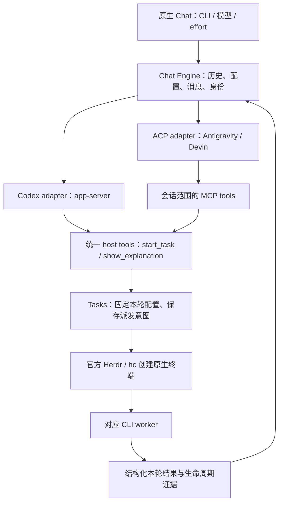

# Herdr main chat 的 CLI、模型和推理强度

状态为已接受、实施中的设计。2026-11-10 基于 `2cc46a1` 检查源码。用户已选择“模型菜单内选强度”并要求实现。新任务继承本轮 CLI、模型和 reasoning effort。随后用户明确要求 Antigravity 和 Devin 默认 YOLO，不再人工批准；这取代下文之前的人工审批保留方案，Codex 策略保持原样。

## 用户看到的变化

保留原版 Herdr 左栏、space、tab 和终端。当前 chat 的输入区增加 CLI 选择器，以及包含模型和 Reasoning effort 的模型菜单。默认 CLI 仍为 Codex。模型和强度的首次值取已验证的 CLI 配置，切换后记住每个 CLI 最近使用的有效组合。

参考 [Arc AI Composer](https://uiarc.dev/components/blocks/ai-composer) 的圆角输入面、底部工具条和发送／停止状态。推荐把模型和 effort 放在同一菜单，关闭时也显示“模型 · 强度”，符合用户“模型里选 reasoning effort”的要求。三项并列作为可比较的备选。用原有 GPUI 控件实现。该参考是 React 组件，不需要把现有工作台迁到 React 或 WebView。

```text
┌────────────────────────────────────────────────────────────┐
│ 描述任务，或问一个问题…                                      │
│                                                            │
│ [Codex ▾] [GPT-6.1-Sol · Low ▾]                       [↑]  │
└────────────────────────────────────────────────────────────┘
```

这里的模型名是本机目录读到的示例，不是产品硬编码默认值。不增加执行计划、任务表单、检查 agent、第二个执行面板或 Dolly 标志。理解类问题仍可返回现有交互解释卡片；任务创建只返回简短文字，终端继续走原版左栏。

交互约定如下。

- CLI 变化时，重新获取该 CLI 在当前接入方式下允许的模型，恢复它上次的有效选择。没有有效偏好时，明确显示 CLI 默认值。
- 模型变化时，仅保留该模型支持的 effort。旧值不支持时，界面显示新模型的默认值和简短提示；用户发送前能看到实际选择。
- effort 是模型能力，不是全局固定枚举。支持哪些值就显示哪些值；没有此能力时显示不可操作的“此模型不提供强度选项”。不要把 `max`、`xhigh` 或 `ultra` 强行映射成另一档。
- 主聊天正在启动、回复、有排队消息或状态未知时，暂时锁定三个选项。停止按钮只中断本轮主聊天；收到实际终止结果前仍保持锁定。已经派发的执行任务在原生终端控制。
- 主聊天空闲后可以切换配置，即使上一项执行任务仍在运行。旧任务维持原 CLI、模型和强度，结果仍回到原聊天。项目内仍只允许一个运行中或状态未知的执行任务。
- 草稿不因切换、目录加载失败或服务端拒绝配置而丢失。模型不可用时显示原因，不自动换模型、降强度或改用 Codex。

## 调用方先行

UI 读取一个 snapshot，提交配置，发送消息。传输细节不进入 UI。

```ts
const snapshot = await chat.open({ conversation, cwd, space });
// snapshot.catalog 含 CLI、可选模型和每个模型的 effort 选项。

await chat.configure({
  conversation, requestId: selectionId, expectedRevision,
  catalogRevision,
  selection: { provider: "devin", modelChoice: "opus-choice", effortChoice: "high" },
});

await chat.send({ conversation, requestId: messageId, expectedProfileRevision, text });
// Bridge 在接受时固定本轮配置、上下文和工具操作身份。
// start_task 从本轮配置派生新任务，不接受模型自行指定 provider/model 的参数。
```

服务端对配置和请求采用版本检查。旧窗口携带过期配置版本时，刷新选项并保留草稿，不让一次竞态把消息送到另一组配置。

## 接入方式与本轮证据

| CLI | 主聊天入口 | 模型／effort 证据 | 执行任务入口 |
| --- | --- | --- | --- |
| Codex | 保留 native app-server | 本机 `model/list` 返回模型、支持的 effort 和默认 effort | 保留共享 app-server 与真实 Codex TUI |
| Antigravity | `agy acp`，JSON-RPC stdio | 本机 `agy models` 可列模型；有的具体 ID 包含 effort。ACP 会话目录仍需确认 | Herdr 创建真实 `agy` 终端，由该终端拥有执行会话 |
| Devin CLI | `devin acp`，JSON-RPC stdio | 本机 `devin models list --format json` 返回 family 和 variants | Herdr 创建真实 `devin` 终端，由该终端拥有执行会话 |

本机 Codex 为 0.162.1、Antigravity 为 1.5.0、Devin CLI 为 3000.12.17。两个 ACP `initialize` 握手和三种模型目录读取成功。没有发送模型 prompt；这些读操作不能证明登录后的完整聊天、工具调用、只读约束、worker 回报或某个模型实际可运行。

Antigravity 官方提供 ACP，并要求自定义客户端如实声明身份；普通 CLI 列出的第三方模型不等于自定义 ACP 客户端能用的模型。其 resume 可以不回放历史，同时发送 prompt 还可能变成对当前轮的 steering。适配层必须处理这些差异。[Antigravity ACP 文档](https://antigravity.google/docs/ide/extensions/acp/)

Devin 官方展示了通过 ACP 接入自定义编辑器的路径。本设计使用本地 Devin CLI，Devin Cloud 不在本次范围内。[Devin ACP 集成](https://docs.devin.ai/cli/acp/zed)

## 系统边界



Bridge 继续是聊天状态的唯一写入者。三个 provider 使用一个固定注册表，生成 UI 选项并创建 adapter，不建设可安装的插件框架。Codex wire types、ACP wire types 和各 CLI 的配置格式都封装在 adapter 内。

| 模块 | 职责 |
| --- | --- |
| `model.ts` / `store.ts` | 版本化存储，conversation、segment、run、profile、task 和操作回执；原子持久化 |
| `engine.ts` | 配置变更、上下文交接、消息队列、主聊天生命周期、host tool 授权与操作身份 |
| `tasks.ts` | 项目排他、固定任务来源配置、派发、结果去重和恢复 |
| `providers/codex.ts`（拟新增） | 收拢现有 Codex 协议与目录／配置解析 |
| `providers/acp.ts`（拟新增） | ACP 通信、会话目录／配置能力和 provider 差异；不承担任务业务 |
| `workers/native-cli.ts`（拟新增） | Antigravity／Devin 原生启动、任务范围配置、hooks／export 解析与恢复 |
| `herdr.ts` | 唯一 Herdr 终端创建边界；保持官方 skill 的原生流程 |
| `tools.ts` | 共享工具 schema 和指令；Codex dynamic tools 与 MCP 使用同一业务处理器 |
| `http.ts` / 原生 `main.js` | snapshot、configure、send 和 composer 控件 |

## 配置数据结构

按 Model the Domain 原则，把一次 CLI、模型、effort 选择建模为完整配置。持久化 schema 是唯一来源，TypeScript 类型由 schema 推导。下面是设计签名，不是已实现 API。

```ts
type Provider = "codex" | "antigravity" | "devin";
type EffortOptions =
  | { kind: "unsupported" }
  | { kind: "choices"; options: readonly { id: string; label: string }[]; defaultId: string };
type ModelChoice = { id: string; label: string; effort: EffortOptions };
type Selection = { provider: Provider; modelChoice: string; effortChoice: string | null };
type Profile = Readonly<{
  id: ProfileId;
  selection: Selection;
  catalogRevision: string;
  resolved: AdapterOwnedSettings;
}>;
type RunOrigin = Readonly<{
  conversation: ConversationId; segment: SegmentId;
  run: RunId; request: RequestId; profile: Profile;
}>;
type SessionOwner =
  | { kind: "main"; conversation: ConversationId; segment: SegmentId }
  | { kind: "worker"; task: TaskId };
type Admission =
  | { kind: "accepted"; origin: RunOrigin; resultContextIds: readonly EntryId[] }
  | { kind: "rejected"; reason: string };
```

模型 ID 只在 provider 内有意义。`resolved` 是 adapter 解析后的具体配置，不能由 UI 任意构造。目录 resolver 必须验证所选组合可同时用于主聊天和对应 worker。Codex 可使用独立 model/effort 字段；其他 CLI 可能要求具体 variant ID。不能用字符串截尾猜测 family，也不能根据显示名称把一个 CLI 的模型 ID 直接传给另一个 CLI。

目录来源优先使用实际会话配置能力；Codex 使用 `model/list`，Devin 的 JSON family/variant 目录可作辅助，Antigravity 的终端目录只能作辅助。保存请求值与服务端确认值，确认不一致时显示差异并停止派发。无法证明某个 effort 生效时不展示可用。带有额外自动委派语义的模式需符合当前单 worker 约束后才能开放。

区分 `missingCli`、`needsLogin`、`catalogUnavailable`、`unsupportedProfile` 和 `ready`。缓存目录可用于展示，发送和派发前仍校验有效性。升级 CLI 后重新核验能力；不要把某个版本的列表永久写入 UI。

## 会话、工具与任务身份

一条 Herdr conversation 保留完整可见历史。切换 CLI 创建新的 provider segment，并向新会话交接已完成的历史和任务摘要；不是跨 CLI resume。同一 CLI 更换模型／effort，若能证明逐轮应用正确则从下一轮生效，否则新建 segment。任何路径都不能修改已接受请求的配置。

首版交接使用有长度上限的确定性文本包。包含已完成的可见消息、解释文本、任务 ID 和结果，不包含当前待发请求、未来队列、隐藏推理、凭据或可执行工具调用。超限时保留草稿并提示缩小交接范围，不悄悄丢上下文。保存交接边界和具体文本，主聊天每轮所用结果条目也在发送前固定。

一次只有一个主聊天请求在 provider 内执行，避免把 ACP 排队消息误当作 steering。配置切换成功后，旧连接的延迟事件不能触发新任务。`conversationId`、本地 `segmentId/runId`、provider、owner 和 connection epoch 共同路由事件；不能继续用裸 `threadId` 查找任务或聊天。

ACP 本身负责通信。Codex 使用原生 dynamic tools，Antigravity 使用会话范围 stdio MCP helper。Devin 按用户追加要求采用本地 CLI helper，不依赖当前组织禁止的 MCP server。三条路径调用同一份 Bridge 业务逻辑。[ACP 会话与 MCP 配置](https://agentclientprotocol.com/protocol/session-setup)

Devin helper 只接受派发任务和生成解释两种操作。主聊天的命令许可按固定可执行文件、脚本、私有 binding、操作身份和编码参数匹配，不批准任意 shell。参数进入 Bridge 后仍须通过 schema、会话所有权、active run 和回执校验。私有 XDG 配置与进程沙盒隔离项目写入、其他会话凭据和本地管理 socket；不修改组织的 MCP allowlist。2026-11-10 的隔离 ACP 探针已证明真实文件读取、两次本地 helper 调用，以及内建文件写入被 OS 拒绝；后续完整原生派发、文件读回、配置继承和结果回传也已通过，见[验证记录](main-chat-verification.md)。

Bridge 为每个主聊天 run 预留一个派发操作身份。通过工具参数携带的操作 ID 仅用于关联；会话范围 IPC 凭据才提供授权。不要把 ACP `toolCallId` 和 MCP JSON-RPC request ID 当作同一个身份。相同操作、相同参数返回原回执；不同参数复用已提交操作时返回冲突。未提交操作只在它所属的 active run 内有效；已结束、取消或旧连接不能首次创建效果。已提交操作可以查询原回执。

`start_task` 的输入只包含任务内容，worker 的完整 profile 从该 run 派生。先原子保存 task intent、profile、项目占用和原生 tab 标识，再产生外部效果。调用方收到“已创建”前，必须核验官方 `hc` 创建的真实 terminal 和对应 space/tab/任务标签。Codex 实现已改为确认终端后提交首轮 prompt；运行验证核对了真实终端、所选配置和文件结果。

Antigravity／Devin 使用独立的终端所有权，不假设 ACP 创建的会话能与 native TUI 同时 attach。任务范围配置和 reporter 不能覆写共享用户配置或仓库 hooks。按用户最新要求，Antigravity 任务终端使用 `--dangerously-skip-permissions`，Devin 使用 `--permission-mode dangerous`。两者默认自动执行，不等待人工 approve；后续对话仍在真实 CLI 终端进行。主聊天的只读／派活职责单独配置。

候选结果通道是原生生命周期 hooks 加结构化 transcript/export。Antigravity 的 Stop 带 `conversationId`、`executionNum` 和 `fullyIdle`；后者为 false 时不能释放任务占用。[Antigravity hooks](https://antigravity.google/docs/hooks/) Devin 的 hooks 提供 `session_id` 和每轮 `prompt_id`；仍需实测 Stop、导出顺序和后台进程是否结束。[Devin lifecycle hooks](https://docs.devin.ai/cli/extensibility/hooks/lifecycle-hooks)

回报键绑定原 task/session/turn。Bridge 中断时 reporter 写任务私有 spool，恢复后交给唯一 writer 去重归档。不要把屏幕文字、进程退出、模型自行调用完成工具或导出文件出现等同于任务成功。记录“本轮完成／失败／中断”，目标是否达成以返回内容及实际检查为依据。

旧终端的后续 turn 也必须重新获得项目执行占用。若无法在首个动作前执行这个检查，就让该 session 在确认关闭前继续占用项目，并明确提示限制，不声称与 Codex 已有体验等价。

## 权限与故障约定

主聊天负责理解、读取、解释和派活；写入任务由 worker 执行。Codex 保留当前只读配置。新 CLI 的只读策略必须实测能约束内建写工具、shell、子进程和继承配置。关闭 ACP 的客户端 write/terminal 能力或写一段只读 prompt 都不够。Devin 用户级 `--config` 也可能受更高优先级项目配置影响。[Devin 权限优先级](https://docs.devin.ai/cli/reference/permissions)

新 provider 的主聊天只读、两个 host tools、所选模型配置、原生终端和结果恢复全部通过后，才将对应选择标为可用。未通过时显示具体原因，不替换成另一 CLI。两个新 worker 的 YOLO 是用户明确指定的执行策略，不作为主聊天只读约束的替代。

一次未知的外部效果不得自动重放。主聊天发送前、worker 启动前保存 attempted/intent；丢失确认后进入 unknown，通过原 provider 的权威状态和任务启动证据恢复。无法确认就保留未知状态和项目占用。新登录、模型不可用和恢复失败分别呈现，故障只影响所拥有的连接／会话。

结果永远写入 `task.origin.conversation`，并与 report receipt 原子保存。主聊天切到别的 CLI 不会改变回报位置，也不把结果作为未经用户请求的新指令立即发给新模型。

## Feature map 与验收顺序

| 能力 | 设计状态／本轮证据 | 实现验收 |
| --- | --- | --- |
| Codex 旧数据兼容 | 设计为 v1 原子迁移到显式 Codex profile | 历史、请求 ID、任务和已回报结果不变；重复打开不重复迁移 |
| CLI 选择与故障隔离 | ACP 初始化通过，未完成聊天链路 | 三 CLI 真回复、独立断连、真实身份与登录状态 |
| 模型与 effort | 三目录读取通过，尚未验证逐轮应用 | 动态选项、默认值、过期偏好、拒绝配置、实际生效值 |
| 完整配置继承 | 已有有界规格检查 | 新 worker 精确继承来源 run，后续切换不改变旧任务 |
| 主聊天 host tools | 统一 handler／MCP 设计 | 三 CLI 各实际调用派活和解释工具，重试不重复创建 |
| 原版左栏任务 | 当前 Codex 有既有证据；另两种是方案 | 用 Herdr skill 创建，核对 space/tab/foreground，实看左栏并进入终端 |
| 权限归属 | 主聊天只读；Antigravity/Devin worker 默认 YOLO；Codex 原策略 | 主聊天负向写测试；新 worker 无需批准完成文件任务；Codex 审批归属仍验证 |
| 完成与后续对话 | hooks/目录是可行路径证据 | 真文件结果、原终端追问、每轮一次回报、后台任务和中断 |
| crash 与 replay | 有界模型已检查，不是源码证明 | 在外部效果前后杀进程，恢复原任务，不盲目重派 |

实施顺序是先迁移身份并抽出 Codex adapter，保持现有链路；再做 catalog/profile/composer；然后逐个打通 Antigravity、Devin 的主聊天与原生 worker 全链路；最后做三者切换、故障注入与真实 Herdr 验证。每个阶段都有可独立验证的产物。

## 状态规格和设计选择

形式验证材料在 [main-chat-providers-design](../../verification/main-chat-providers-design/README.md)。模型检查的是拟议约定，尚未映射到新产品源码。分别检查配置切换、任务归属，以及 CLI/model/effort 组合和任务配置不变性。第三方 CLI 的权限、模型访问、hooks、UI 和真实崩溃恢复都需要实现后的运行证据。

按 Exhaust the Design Space 原则比较了统一历史分段、每 CLI 独立历史、全 ACP gateway 三种结构。选择统一历史分段加 Codex 原生／ACP 混合适配。独立历史让 CLI 选择变成隐含的聊天切换；全 ACP gateway 要重做当前已验证的 Codex 终端链路。

架构候选 A 为基底，采用其 host-owned 操作身份和原生终端后续 turn 占用约定；从 B 合入主聊天忙碌时锁定配置，以及 request 预先绑定结果上下文。独立交叉评审同意这一选择，并要求补齐用户后来提出的模型和 effort。本文已把完整 profile 贯穿目录、请求、任务和恢复。第三个候选因运行容量未启动；父模型家族不可见，无法核验评审跨家族。

评审建议三个控件并列；最终 UI 采用模型菜单内选择强度，以遵循用户指定的参考和描述，同时在菜单关闭时保留强度标签。两种布局都保存在交互草图中供比较，配置语义一致。

首版接受新 CLI 会话交接的开销、超长上下文需要处理，以及不确定任务暂时阻止新执行的限制，换取明确的历史、配置和执行归属。没有已接受的产品实现偏离；后续实施改变契约时应更新本文同一位置。
