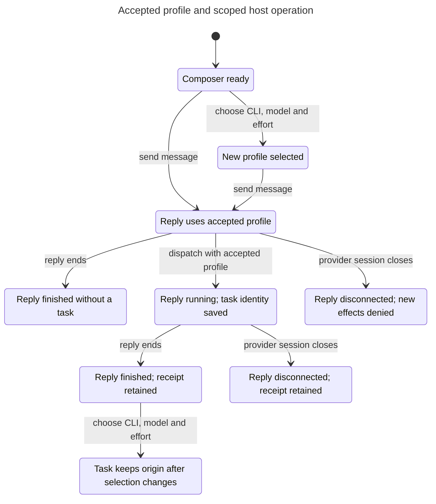

# Herdr chat state check

Accepted requests retain their CLI, model, and reasoning effort. Scoped host calls create one task per operation, and real task outcomes return once. Native terminals retain project ownership until they close.

The [source manifest](source-sync.json) identifies the reviewed code. The [reconciliation record](reconciliation.md) explains changes from the original Codex-only protocol. The [verification guide](README.md) maps model actions to source and lists the exact bounds.

| Model | Reachable states | Explored steps | Result |
| --- | ---: | ---: | --- |
| Dispatch and recovery | 57 | 106 | Pass |
| Dispatch/result ledger | 15 | 17 | Pass |
| Codex approval ownership | 5 | 5 | Pass |
| Accepted profile and host operation | 41 | 101 | Pass |
| Native worker ownership | 14 | 32 | Pass |

TLC 1.7.4 checks all five finite projections. The actual-code suite passes 24 tests and 106 assertions. All 23 deliberate source regressions fail their matching runtime assertions, and all 21 broken model properties produce counterexamples. These results do not prove unbounded event histories, the cross-product of the models, provider internals, UI input, or OS containment.

The [original dispatch counterexamples](evidence/dispatch-before-fix/report.md) remain as historical evidence. Current recovery also retains an unknown attempted launch without replay. The [dispatch chart](evidence/dispatch/chart.mmd) and [native ownership chart](evidence/native-worker/chart.mmd) show those branches.

The profile chart below follows one accepted request and its scoped host operation.

