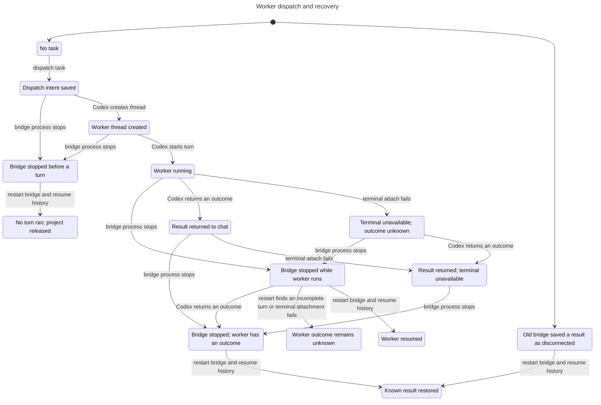

# Herdr chat state check

The checked protocol saves dispatch intent before starting a worker, prevents repeated call IDs from starting another worker, and returns each real outcome once. It leaves worker approval decisions to the terminal.

Checked source: `921cafbbeb12c16c73d0257ddcd33c89f9578fb2`. The sync record pins the covered files, runtime probes, and dependency lock.

| Model | Current states | Current steps | Result |
| --- | ---: | ---: | --- |
| Dispatch and recovery | 67 | 141 | Three invariants and deadlock check pass |
| Dispatch/result ledger | 15 | 17 | Four invariants and deadlock check pass |
| Approval ownership | 5 | 5 | Three invariants and deadlock check pass |

TLC 1.7.4 exhaustively checked these finite models. They cover one task, one turn, one process crash, three outcomes, one duplicate dispatch, and one duplicate result. Recovery also checks an old saved task whose known outcome was marked disconnected. They do not prove the whole application or an unbounded protocol.

The original 77-state dispatch model found two defects, now fixed:

- `RecoveredEmptyTaskReleased`: a task with no started turn must stop blocking its project. Original report path 0–5 saves the thread ID, crashes, then leaves empty history launching.
- `RecoveredOutcomeKnown`: authoritative completed history must restore finished state. Original report path 0–9 saves a result, fails terminal attachment, crashes, then lets report deduplication prevent state reconciliation.

The current runtime suite passes 11 tests. It kills a real bridge child at the launch boundary, reloads a saved legacy task, and replays completion before terminal attachment fails. All ten deliberate source regressions fail their matching runtime assertions. Deliberately broken model configurations fail the matching invariants too.

Run `bun verification/herdr-chat/check.ts` and `bun verification/herdr-chat/mutations.ts` with Bun 1.4.4. The first command checks the source hashes, installs the pinned verifier through mise, and writes logs to a new temporary directory. Read each formal result with pstack `/statechart`. [The verification guide](README.md) maps actions to exact functions and lists assumptions. [The original counterexamples](evidence/dispatch-before-fix/report.md) remain available.

This generated chart groups save acknowledgements and terminal attachment while work is running. The full model retains those crash boundaries.

