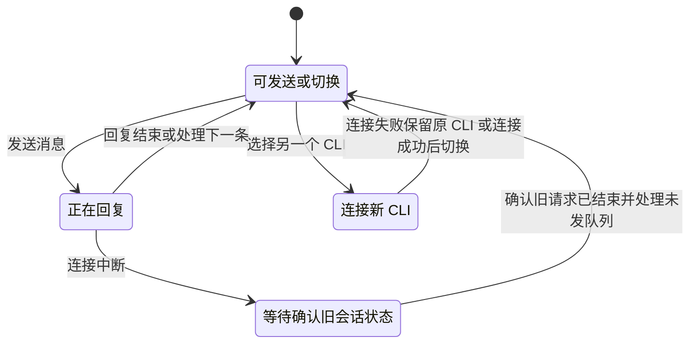
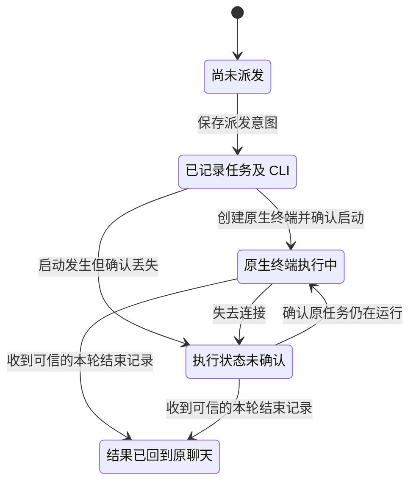

# Main chat provider design verification

These are historical specifications for the proposed design, not a proof of implemented multi-provider support. Product source was at `2cc46a1` when these models were checked on 2026-11-10 with the installed pstack statechart workflow and TLC. Current source mappings, runtime replays, and native ownership models are in [the implementation verification](../herdr-chat/README.md).

## Results

| Projection | Reachable states | Checked safety properties | Evidence |
| --- | ---: | --- | --- |
| ProviderSwitch | 34 | Accepted request stays on its generation; no switch with pending work; old-generation tools cannot create new effects | [Report](evidence/switch/report.md), [chart](evidence/switch/chart.mmd) |
| TaskProvider | 23 | Worker retains origin provider; no second launch or repeated result; unknown is not completion | [Report](evidence/task/report.md), [chart](evidence/task/chart.mmd) |
| ProfileSelection | 378 | CLI/model/effort combination is valid; task profile remains fixed and valid | [Report](evidence/profile/report.md), [chart](evidence/profile/chart.mmd) |

All three also pass deadlock checking under explicit stuttering. No liveness guarantee is claimed. State counts describe exhaustive finite exploration of these abstractions, not test coverage or production scale.

The generated main-chat chart has four visible states. Queueing and accepted tool events that remain in the same visible state are omitted from the drawing, not from the checked model.



The worker chart preserves the original execution owner while the main chat can change.



Six deliberately broken transitions are enabled by the negative configurations. Their failures are expected.

| Broken transition | Shortest counterexample | Evidence |
| --- | --- | --- |
| Accept old session tools | Choose CLI, commit switch, send, accept old tool | [Switch negative report](evidence/switch-negative/report.md) |
| Retarget worker on selection | Reserve task, switch CLI | [Task negative report](evidence/task-negative/report.md) |
| Retry unknown launch | Reserve, launch loses acknowledgment, replay | [Task negative report](evidence/task-negative/report.md) |
| Append duplicate result | Reserve, launch, report, duplicate report | [Task negative report](evidence/task-negative/report.md) |
| Accept unsupported model/effort | Choose invalid pair, accept; dispatch propagates it to worker | [Profile negative report](evidence/profile-negative/report.md) |
| Rewrite existing task profile | Dispatch, choose another profile, accept | [Profile negative report](evidence/profile-negative/report.md) |

These counterexamples exercise the proposed guards. They were not replayed against product code because product implementation had not started when this design record was written. No current product defect is asserted by these negative variants.

## Bounds and abstractions

ProviderSwitch has one conversation, three CLI values, at most one provider switch, one active request and one queued-message bit. Reconcile abstracts authoritative confirmation plus explicit resolution of unsent messages. It does not model obtaining that evidence. Main connection events are abstract inputs.

TaskProvider has one task and one original conversation, three provider values, one optional provider switch and at most two launch/report counts in negative variants. There are no unbounded IDs, real hooks, terminal processes, auth, two-conversation collisions or concurrent worker reservations. Original-conversation delivery is structurally fixed in this projection; cross-conversation routing needs a runtime test. The no-replay guard is tested with lost launch acknowledgment.

ProfileSelection uses six allowed synthetic profiles across three CLIs and two invalid combinations. It models atomic admission and an existing task's frozen profile. It has no real model catalog, dynamic permission changes, native configuration application or server-confirmed effective values. The three projections are checked separately; their cross-product, filesystem durability, multiple bridge writers and native follow-up exclusion are not proven.

Charts combine states with the same visible phase and omit transitions that stay within one displayed state. The negative profile graph exceeds the 500-state chart budget, so its chart shows only counterexample paths. Raw reports preserve the checked results. No transition is intentionally filtered from the model.

## Reproduce

Copy this directory to a fresh scratch directory. The statechart workflow uses mise for TLC and Java. Run with the installed skill path, replacing `scratch` and `output` with fresh absolute paths:

```sh
statechart /scratch/ProviderSwitch.tla --config /scratch/ProviderSwitch.cfg --view /scratch/switch-view.mjs --out /output/switch
statechart /scratch/TaskProvider.tla --config /scratch/TaskProvider.cfg --view /scratch/task-view.mjs --out /output/task
statechart /scratch/ProfileSelection.tla --config /scratch/ProfileSelection.cfg --view /scratch/profile-view.mjs --out /output/profile
```

Here `statechart` means `~/.codex/plugins/cache/pstack-claude/pstack/0.9.133/skills/statechart/scripts/statechart`. To check sensitivity, substitute the matching `-negative.cfg` and a different output directory. Negative runs exit nonzero. Runtime scripts and model source must be reconciled before claiming the implementation satisfies these rules.

## Protocol and catalog observations

The design probe launched isolated `agy acp` and `devin acp` processes, sent only `initialize`, recorded non-secret capabilities and terminated those owned processes. It created no session and sent no model prompt. See [Antigravity initialization](evidence/antigravity-initialize.json) and [Devin initialization](evidence/devin-initialize.json).

A separate Codex app-server process answered `initialize` and `model/list`, then exited. See [Codex model metadata](evidence/codex-models.json). The installed `devin models list --format json` supplied [Devin family/variant metadata](evidence/devin-models.json), filtered to labels and IDs. `agy models` also returned Gemini 4 Argon, Gemini 3.8 Flash and other model variants. Its native catalog is not evidence of custom ACP access to third-party models.

These observations establish discovery entrypoints only. Main read-only policy, actual model/effort use, task-scoped hooks, worker configuration, live terminal visibility, approval ownership and recovery remain implementation gates in the [design and feature map](../../docs/design/main-chat-providers.md).
